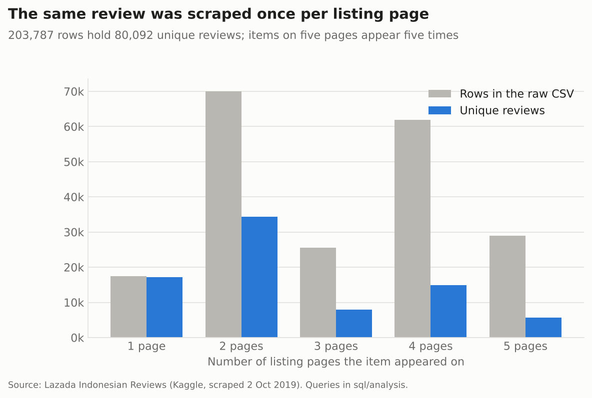
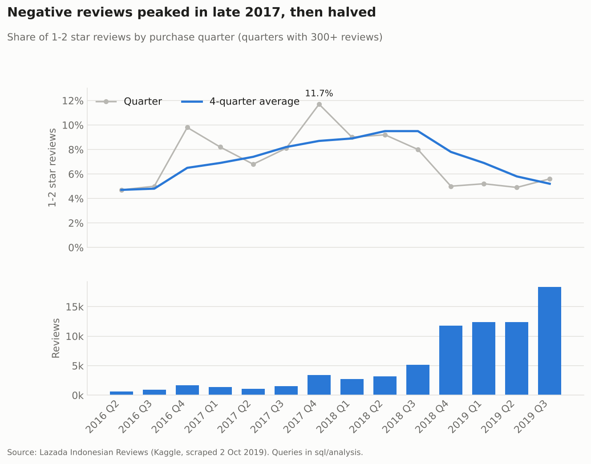
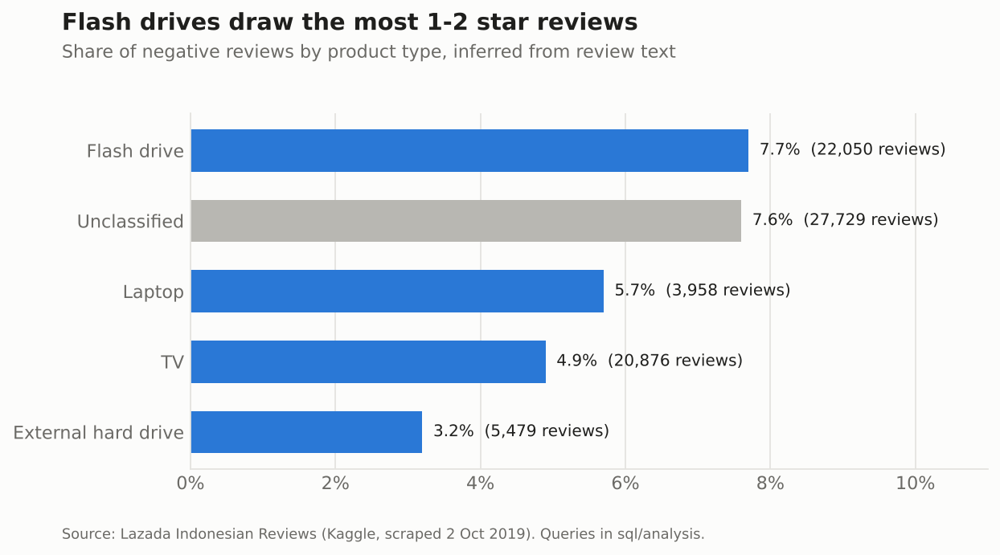
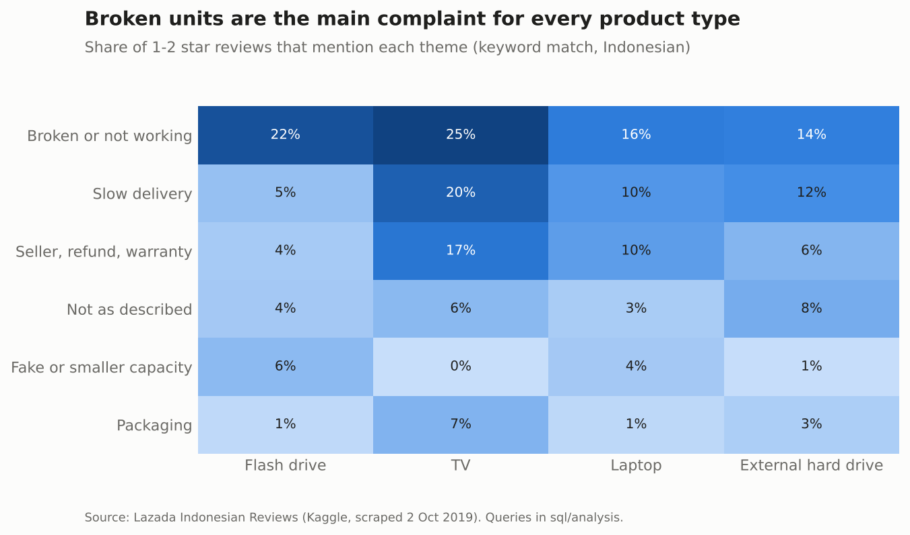
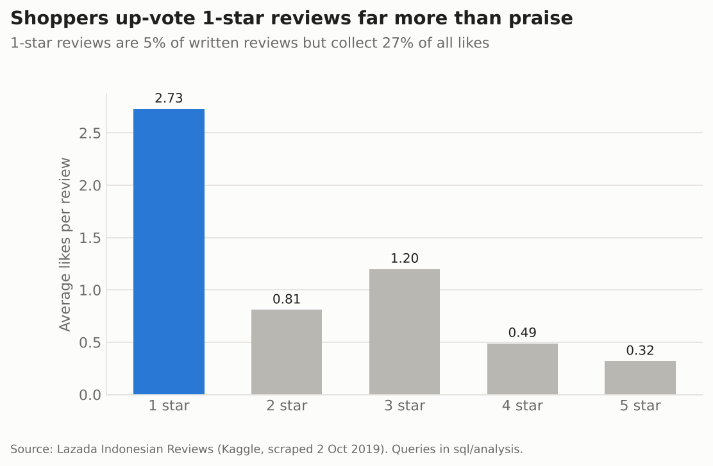
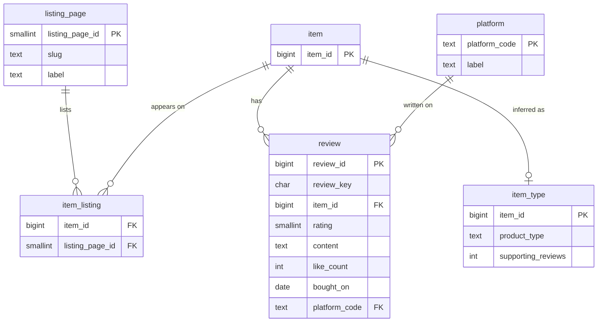

# Lazada Indonesia reviews in PostgreSQL

A PostgreSQL project on 203,787 product reviews scraped from Lazada Indonesia in October 2019 (storage devices, TVs and laptops). The raw file is loaded into a staging table, cleaned into a normalised schema with plain SQL, and analysed with SQL queries. Python is only used to draw the charts from the query results.

The questions:

1. How much of the scrape is usable once duplicates are removed?
2. How did the share of 1-2 star reviews change over time?
3. Which products draw the most complaints, and what do buyers complain about?
4. Which individual items should a category manager look at first?

## Findings

**Most of the file is duplicated.** The scraper collected reviews from five category pages, and 75% of items appear on more than one of them, so their reviews were saved once per page. After deduplication 80,092 unique reviews remain out of 203,787 rows. It also means the category column cannot be used to compare product types; an item listed under "flash drives" can also appear under "smart TVs".



**Negative reviews peaked in Q4 2017 at 11.7% and were back near 5% through 2019**, while quarterly review volume grew from about 600 in mid-2016 to more than 18,000 in Q3 2019.



**Flash drives are the weak spot.** Since the category labels are unreliable, each item's product type is inferred from the words its reviewers use ("flashdisk", "tv", "laptop" and so on). This covers 65% of reviews. Flash drives have the highest share of 1-2 star reviews (7.7%), more than twice that of external hard drives (3.2%). 17 of the 20 items on the watchlist (`results/07_item_watchlist.csv`) are flash drives.



**Broken units are the top complaint for every product type.** For TVs, slow delivery (20%) and seller or warranty issues (17%) come close behind, which points at the shipping and after-sales side rather than the product. Fake or smaller-than-advertised capacity shows up mostly for flash drives.



**Shoppers read the critical reviews.** 1-star reviews make up 5% of written reviews but collect 27% of all likes, about eight times more likes per review than 5-star ones. A bad review on a popular item is seen by more people than its share suggests.



Two more results are in `results/`: reviews written from a mobile app with no recorded OS have a 16.4% negative share against 5.9% for the Android app (`08_platform.csv`).

## Schema



Cleaning decisions, all in `sql/02_transform.sql`:

- Purchase dates use Indonesian month names (`17 Agu 2018`); `staging.parse_id_date()` converts them.
- A review is identified by an md5 of item, reviewer, rating, text, date and like count. The reviewer name goes into the hash and is not stored.
- Seven rows have a like count of -1; they are set to 0.
- The `helpful` column is `true` on every row and was dropped.

## SQL worth a look

**Ranking items fairly.** Sorting by the raw negative share rewards items with few reviews, where one or two complaints swing the number. `07_item_watchlist.sql` keeps items with 100+ reviews and ranks them by the lower bound of a 95% Wilson interval, so an item needs both a high share and enough reviews to rank:

```sql
(negative::numeric / reviews + 1.96 ^ 2 / (2 * reviews)
   - 1.96 * sqrt((negative::numeric / reviews * (1 - negative::numeric / reviews)
                  + 1.96 ^ 2 / (4 * reviews)) / reviews))
/ (1 + 1.96 ^ 2 / reviews) AS p_lower
```

**Inferring product type from text** (`04_item_type.sql`): regex matches per item, `row_number()` to pick the most mentioned type, and a 60% share threshold so mixed items stay unclassified.

**Complaint themes** (`06_complaint_themes.sql`): a `VALUES` list of themes and Indonesian keyword patterns joined to negative reviews with the `~` operator.

Other techniques used: window functions for moving averages and shares of total (`04`, `03`), `ntile` deciles, `FILTER`, `DISTINCT ON` for deduplication.

## Run it

Needs PostgreSQL 13+ and Python 3.10+.

```bash
pip install -r requirements.txt
# download the CSV first, see data/README.md
export PGHOST=localhost PGUSER=postgres   # adjust to your setup
./run_all.sh
```

`run_all.sh` creates the `lazada_reviews` database, loads and cleans the data, writes every query result to `results/` and redraws the charts. A full run takes under a minute.

## Layout

```
sql/
  01_schema.sql           staging and cleaned tables
  02_transform.sql        load staging into the cleaned tables
  03_views.sql            views shared by the analysis queries
  04_item_type.sql        product type inferred from review text
  analysis/               one question per file, results go to results/
scripts/make_charts.py    charts for this README
results/                  query output as CSV
images/                   charts
```

## Data

[Lazada Indonesian Reviews](https://www.kaggle.com/datasets/grikomsn/lazada-indonesian-reviews) on Kaggle, file `20191002-reviews.csv`. The data is not redistributed here; see `data/README.md` to download it.

Limits: the scrape covers the reviews visible on 2 October 2019 for items on five listing pages, so it is not a random sample of Lazada reviews. Product types and complaint themes come from keyword matching and will miss reviews that use other words.
